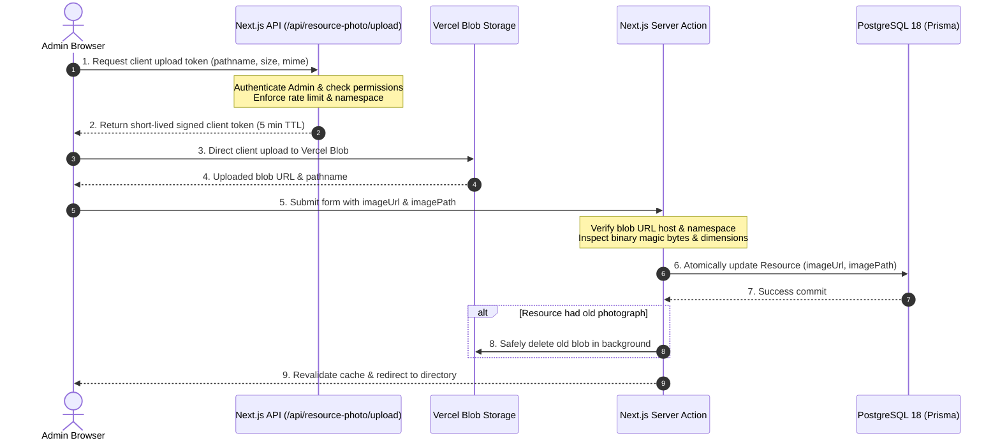

# PrimeWave — Resource Photo Management

## 1. Overview and Architecture

PrimeWave provides secure, scalable single-primary photo management for shared organizational resources.



### Key Architectural Decisions
- **Object Storage vs Database Storage:** Image binary data is stored in Vercel Blob; PostgreSQL stores only metadata references (`imageUrl`, `imagePath`). PostgreSQL is never burdened with large binary payloads.
- **Direct Client Upload:** Photographs are uploaded directly from the browser to Vercel Blob using `@vercel/blob/client`'s `upload()` flow, avoiding serverless function payload limits (4.5 MB) and execution timeouts.
- **Serverless Token Authorization:** The browser cannot upload without a server-generated client upload token. Tokens are issued by `/api/resource-photo/upload` only to active administrators who have completed their initial password change.
- **Fail-Safe Cleanup:** When an existing image is replaced or removed, the previous blob is deleted only *after* the PostgreSQL transaction successfully commits. If the transaction fails, newly uploaded blobs are immediately cleaned up to prevent orphaned storage leaks.

---

## 2. Security and Validation Safeguards

### Server-Side Authorization
All image mutations and token generation require:
- Active session authenticated with `UserRole.ADMIN`.
- User account status `AccountStatus.ACTIVE`.
- Mandatory password change completed (`mustChangePassword === false`).
- Token rate limiting (30 requests per minute per administrator).

Non-admin roles (`EMPLOYEE`, `DEPARTMENT_HEAD`) and unauthenticated requests are rejected with `401 Unauthorized` or `403 Forbidden`.

### Binary Magic Byte Verification
The server does not trust client-declared MIME types or file extensions. Before saving an image reference to the database, `storage-service.ts` inspects the initial byte headers:
- **JPEG:** `0xFF 0xD8 0xFF`
- **PNG:** `0x89 0x50 0x4E 0x47 0x0D 0x0A 0x1A 0x0A`
- **WebP:** `RIFF....WEBP`

Disguised executables, HTML scripts, and unsupported formats are rejected and immediately deleted from storage.

### Decompression Bomb Mitigation
Uncompressed bitmap rasterization is avoided to protect server memory. Instead, width and height are extracted directly from header chunks:
- **PNG:** Big-endian dimensions in the `IHDR` chunk.
- **JPEG:** Big-endian dimensions in the `SOF` frame marker.
- **WebP:** Little-endian dimensions in `VP8`, `VP8L`, or `VP8X` chunks.

Limits enforced:
- Maximum file size: **3 MB** (3,145,728 bytes).
- Maximum dimensions: **4096 × 4096 pixels**.
- Minimum dimensions: **10 × 10 pixels**.

### Storage Namespace Protection
Upload paths are restricted to the `resources/{resourceId or 'drafts'}/{filename}` namespace. Path traversal characters (`..`, `\`, redundant slashes) are sanitized.

---

## 3. Database Schema

The database model is updated with additive, optional fields:

```prisma
model Resource {
  // Existing fields...
  id               String           @id @default(dbgenerated("gen_random_uuid()")) @db.Uuid
  resourceCode     String           @unique @db.VarChar(64)
  name             String           @db.VarChar(120)
  // ...
  imageUrl         String?          @db.Text
  imagePath        String?          @db.Text
  // ...
}
```

- Migration file: `prisma/migrations/20261013000000_add_resource_photo/migration.sql`.
- Existing records default to `NULL` image fields without data loss or table downtime.

---

## 4. UI/UX Design System Compliance

All photo controls adhere to `docs/design-system.md` and semantic tokens in `src/app/globals.css`:
- **Management Form (`src/components/resource-form.tsx`):**
  - Clean rectangular card container.
  - Drag-and-drop zone and native file picker.
  - Instant local preview before submit.
  - Progress feedback during direct upload (`Uploading photograph…`).
  - Dedicated "Replace photo" and "Remove" controls.
  - Client and server validation error banners.
- **Directory & Catalog Tables (`src/components/resource-list.tsx`):**
  - Compact 56×56px (`size-14`) thumbnails.
  - Subtle neutral placeholder icon with category styling when no photo is present.
  - Table row heights remain consistent with no layout shifting.
- **Detail View (`src/app/(protected)/resources/[id]/page.tsx`):**
  - Prominent, responsive hero banner (`aspect-video sm:aspect-[21/9]`).
  - Next.js `<Image>` component with responsive `sizes` attribute.
  - Subtle placeholder container when no photo is attached.

---

## 5. Local Development and Testing

### Environment Variables
Add to your local `.env`:
```env
BLOB_READ_WRITE_TOKEN="vercel_blob_rw_..."
```

### Development Without Vercel Blob Credentials
If `BLOB_READ_WRITE_TOKEN` is not set:
- The resource management forms remain fully operational for creating, editing, and categorizing resources.
- Attempting to upload a photo provides an informative 503 notification:
  `"Vercel Blob storage is not configured. Set BLOB_READ_WRITE_TOKEN in environment variables."`
- The rest of the application runs without disruption.

### Automated Testing
Automated tests in `tests/resource-photo.test.mjs` mock `@vercel/blob` and test:
1. Binary magic byte detection across JPEG, PNG, and WebP.
2. Binary dimension parsing for PNG IHDR, JPEG SOF, and WebP VP8/VP8L/VP8X.
3. Rejection of decompression bombs ($> 4096\text{px}$) and disguised executables.
4. Authorization guards against non-admin roles and unauthenticated callers.
5. End-to-end photo attach, replacement with old blob cleanup, and removal.
6. Safe rollback on transaction failure ensuring no orphaned storage leaks.
